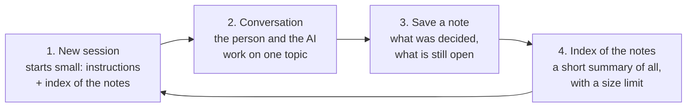
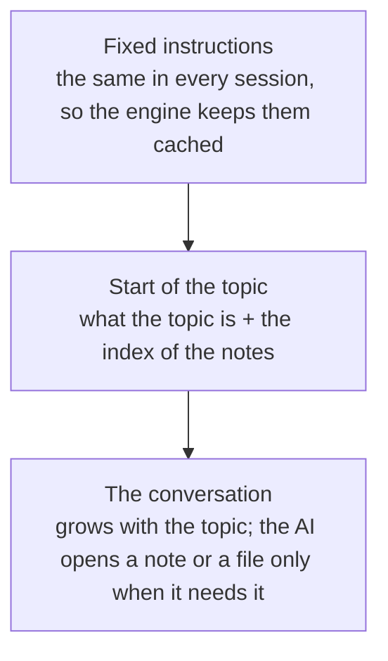

# Context and memory

Long-term memory belongs to the harness; short-term memory belongs to the engine.

## At a glance

The engine forgets; the harness remembers. Each topic runs in a fresh session. When it ends, what matters is saved as a short note, and the conversation is dropped. The next session starts from a short index of the notes, never from old conversations.

If a conversation gets too long before the topic ends, the app saves a note halfway too, so nothing decided is lost when the engine compresses its memory.

What the AI reads in a session, from what never changes to what grows:

Each topic also runs on the model it needs: a small one for simple work, a big one for hard work, chosen when the topic starts and kept until it ends.

## One session per task

- A task is one topic or unit of work: a manifest action, or a free question.
- The app drives the flow (`packages/shell/src/main/task-manager.ts`): idle → running → waiting → closing → idle. A message while waiting follows up in the same session. Picking "next" or another topic closes the current task.
- Closing sends one quiet last turn in the same session (`CLOSE_PROMPT` in `task-prompts.ts`) asking the agent to call `save_note` (a task that used modes also asks it to say what each was good for, and the note's front matter lists their ids). The app validates the note and writes `.harness/notes/<action>.md`, or `.harness/notes/q-<title>.md` for a free question (`q-<title>-2.md`, `-3`… when that name is taken) (`packages/workspace/src/notes.ts`). Then the session is ended: Claude starts the next one with a new `--session-id`, Codex gets `session/close`.
- Cancel, a failed first turn, an engine switch or quitting end the task without a note and mark it unfinished.
- The state lives in `.harness/tasks.json` (`packages/shell/src/main/task-store.ts`).

## What a new session gets

- Everything the agent reads is English. The managed section of `AGENTS.md` tells it to think in English, to write what the person sees in their language (the saved tag by its English name, `languageName` in `harness-sdk`), and to write notes in English.
- The stable instructions: `AGENTS.md` with its managed section. With harness settings, the section has their sentences under "How to work with this person". `AGENTS.md` only changes between tasks, and only when its text changed, so a running session keeps its cached prefix and the next one reads the new text (`docs/architecture/settings.md`). A task that goes on in a new session (after "Move folder", which keeps the open task) reads the settings as they are then; a restart never carries a task over, since startup ends a task left open.
- The first message: the task's brief plus the notes index (`buildNotesIndex` in `packages/workspace/src/notes-index.ts`): what was covered and the decisions so far, newest first, about 1,500 tokens at most. Older notes keep only their title and path; the agent opens a note with its read tool when it needs the details.
- In an action with modes, the first message adds the mode's section (or, by default, the list of modes to recommend from); a switch of mode is one more turn of the same session with the new mode's brief, so the session and its cache stay. A resumed session's first message carries the current mode (`docs/architecture/modes.md`).
- In a harness with scopes, the notes index is the open scope's, followed by a short app-wide one (`APP_INDEX_TOKENS`, 500). Collections with `context` add their tables after it, each within its own `tokens` (`docs/architecture/data.md`).

## Models and context caps

- Each task runs at a level: `light`, `standard` or `deep`. The manifest recommends one per action (`tier`) and for free questions (`questions.tier`); the person can change each task's level, or make it custom, in Settings › Modelos (`config.json` → `models`).
- A mode may ask for a minimum tier (`minTier`). Switching to it from a task below asks the person first: continue at the task's level, or close it and start a new task at the mode's level (`resolveProfile`'s `floor`, which raises a lower tier and never lowers a higher one). The task's level still never changes mid-task (`docs/architecture/modes.md`).
- When a task starts, `resolveProfile` (`packages/shell/src/main/models.ts`) turns its level into a model, an effort and a context cap for the engine in use, from the person's table or the core's (`DEFAULT_TIERS` in `packages/engines/src/models.ts`). The profile is stored with the task in `tasks.json` and never changes until the task ends, so the engine's prompt cache stays valid.
- Claude gets `--model`, `--effort` and `--autocompact` on every call of the task; Codex gets the same through `CODEX_CONFIG` when its adapter starts (a new process when the next task needs another profile).
- A model the plan doesn't include ends the first turn with `model-unavailable`; the task runs again one level down (deep → standard → light → the engine's default model) and the screen says so. On Codex a model missing from its saved list is skipped before the turn.

## Checkpoints

- After each turn the task keeps the context in use (`context` events: Claude's last call, Codex's `usage_update`).
- At 80% of the cap (`CHECKPOINT_AT` in `task-manager.ts`), before the next follow-up, a quiet turn asks the agent for `save_note`: the decisions so far go to the task's note before the engine compacts on its own. The row says "Guardando lo importante…".
- After a compaction (Codex reports it; for Claude the context falls by more than half) the next checkpoint can run again.

## Measuring

`.harness/usage.jsonl` records each turn's tokens with its `task`, `phase` (`run`, `close`, `checkpoint`), `mode` (for a task in a mode), level, model, effort and cap, and the model the engine said it ran (`reportedModel`). Compactions are lines of `kind: "compaction"`.

## Engine switch

The chat is archived, the open task ends unfinished, the notes stay: the next task on the new engine gets the same index (`packages/shell/src/main/engine-switch.ts`).
