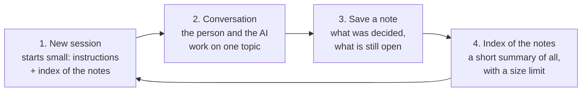
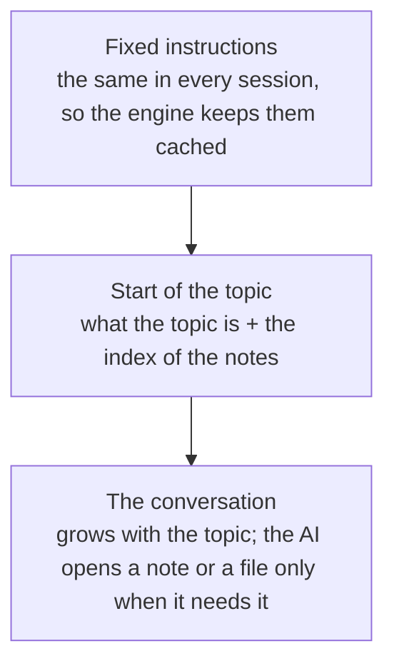

# Context and memory

Long-term memory belongs to the harness; short-term memory belongs to the engine.

## At a glance

The engine forgets; the harness remembers. Each topic runs in a fresh session. When it ends, what matters is saved as a short note, and the conversation is dropped. The next session starts from a short index of the notes, never from old conversations.

If a conversation gets too long before the topic ends, the app saves a note halfway too, so nothing decided is lost when the engine compresses its memory.

What the AI reads in a session, from what never changes to what grows:

Each topic also runs on the model it needs: a small one for simple work, a big one for hard work, chosen when the topic starts and kept until it ends.

## One session per task

- A task is one topic or unit of work: a manifest action, or a free question.
- The app drives the flow (`packages/shell/src/main/task-manager.ts`): idle → running → waiting → closing → idle. A message while waiting follows up in the same session. Picking "next" or another topic closes the current task.
- Closing sends one quiet last turn in the same session (`CLOSE_PROMPT` in `task-prompts.ts`) asking the agent to call `save_note` (a task that used modes also asks it to say what each was good for, and the note's front matter lists their ids). The app validates the note and writes `.harness/notes/<action>.md`, or `.harness/notes/q-<title>.md` for a free question (`q-<title>-2.md`, `-3`… when that name is taken) (`packages/workspace/src/notes.ts`). Then the session is ended: Claude starts the next one with a new `--session-id`, Codex gets `session/close`.
- An action may split its task into ordered parts (`phases`) inside that one session, and the last part may be the close (`close: true`): its end is this same closing turn. A time box runs one wrap-up turn near the end, then moves to the close part (`docs/architecture/phases.md`).
- Cancel, a failed first turn, an engine switch or quitting end the task without a note and mark it unfinished.
- The state lives in `.harness/tasks.json` (`packages/shell/src/main/task-store.ts`).

## What a new session gets

- Everything the agent reads is English. The managed section of `AGENTS.md` tells it to think in English, to write what the person sees in their language (the saved tag by its English name, `languageName` in `harness-sdk`), and to write notes in English.
- The stable instructions: `AGENTS.md` with its managed section. With harness settings, the section has their sentences under "How to work with this person". `AGENTS.md` only changes between tasks, and only when its text changed, so a running session keeps its cached prefix and the next one reads the new text (`docs/architecture/settings.md`). A task that goes on in a new session (after "Move folder", which keeps the open task) reads the settings as they are then; a restart never carries a task over, since startup ends a task left open.
- The first message: the task's brief plus the notes index (`buildNotesIndex` in `packages/workspace/src/notes-index.ts`): what was covered and the decisions so far, newest first, about 1,500 tokens at most. Older notes keep only their title and path; the agent opens a note with its read tool when it needs the details.
- In an action with modes, the first message adds the mode's section (or, by default, the list of modes to recommend from); a switch of mode is one more turn of the same session with the new mode's brief, so the session and its cache stay. A resumed session's first message carries the current mode (`docs/architecture/modes.md`).
- In an action with phases (`docs/architecture/phases.md`), the first message adds `## Parts of this task` (how to use `set_phase`, then one `` - `id` (Label) `` line per part, the current one marked `← now`) and `## Part: <label>` with the first part's brief. No extra turn runs at the start. With a time box, the message ends with `Time left: about N minutes.`
- Moving to another part is one more run turn of the same session: "Next part of this task", the time left, the part's brief and any mode section. A part's brief is filled with `{{language}}`, `{{phase}}` (its label), `{{previousPhase}}` (the label of the part before) and `{{timeLeft}}` (`about N minutes`, empty without a time box); never `{{notesIndex}}`, since the session already has the index. A resumed session's first message carries the list of parts and the current part's section after the mode's.
- In a harness with profiles (`docs/architecture/profiles.md`), everything above is the active profile's: `AGENTS.md` (and the engine's own instructions file) is written in the profile's folder, which is the agent's working folder, with that profile's settings; the notes, the index and the tasks are the profile's. The agent knows the person only through the `profile` collection's `context`.
- In a harness with scopes, the notes index is the open scope's, followed by a short app-wide one (`APP_INDEX_TOKENS`, 500, set by the context policy's start plan). Collections with `context` add their tables after it, each within its own `tokens` (`docs/architecture/data.md`).
- In a harness with `enginePresets`, a task in a scope whose engine config the person approved gets `## Scope instructions` right after the brief, before the notes index: the scope's `instructions.md`, then the action layer's. They stay out of `AGENTS.md`, so its cached prefix is the same across scopes. Later turns, and a task resumed after a move, use the snapshot the task started with while the approval and the folder's hash hold (`docs/architecture/hatches.md`, H3). A scoped job gets none.
- In a harness with `tools`, an action with `pre` steps runs them when the task starts, before its session opens, and the first message gets `## Prepared data` right after the data tables (and before the pins and the material): one block per result, in a fence, cut to the action's `preTokens` (`docs/architecture/tools.md`, "Pre-steps"). A resumed task gets none. A policy whose start plan omits `prepared` leaves the result out of the message; the pre-steps still run.
- In a harness with `material`, a task in a scope with usable material gets a `## Material` section last: the first message's order (the context policy's start plan; this is the default's) is the notes index, the app-wide notes, the data tables, the prepared data, the pinned section, then the material (the scope's grounding rule, the sheet and index rows within `budget.indexTokens`; `materialContext` in `task-manager.ts`). The strict or mixed rule is per scope, so it rides here, not in `AGENTS.md`. `AGENTS.md`'s managed section gets a `### Material` part with the rules that hold in every mode: fetch fragments with `material_read` and `material_search` and never open `.harness/material/`, cite as `[[frag:<id>]]`, follow the material when it and your knowledge disagree, say so once and call `material_conflict`, and call `material_flag` on a fragment that reads wrong. Without `material`, neither exists (`docs/architecture/material.md`). When subagents are allowed for the task (manifest `permissions.subagents: true`, or the scope's engine preset ships `agentsFile`; an explicit manifest `false` wins), the managed section also gets a `### Subagents` part, after Material: the handback contract (at most five lines: a status, what changed, one line per issue; details go in the files edited, never in the reply; no report files). Otherwise it is absent and the section is byte for byte the old one (`subagentLines` in `packages/workspace/src/instructions.ts`; the runtime asks the preset through `RuntimeOptions.instructionSubagents`, which the shell wires, under `enginePresets`, to whether the open scope's approved preset has an `agentsFile`; `instruction-subagents.ts`).

## Models and context caps

- Each task runs at a level: `light`, `standard` or `deep`. The manifest recommends one per action (`tier`) and for free questions (`questions.tier`); the person can change each task's level, or make it custom, in Settings › Modelos (`config.json` → `models`).
- A mode may ask for a minimum tier (`minTier`). Switching to it from a task below asks the person first: continue at the task's level, or close it and start a new task at the mode's level (`resolveProfile`'s `floor`, which raises a lower tier and never lowers a higher one). The task's level still never changes mid-task (`docs/architecture/modes.md`).
- When a task starts, `resolveProfile` (`packages/policies/src/model.ts`, called through the task's `ModelPolicy`) turns its level into a model, an effort and a context cap for the engine in use, from the person's table or the core's (`DEFAULT_TIERS` in `packages/engines/src/models.ts`). The profile is stored with the task in `tasks.json` and never changes until the task ends, so the engine's prompt cache stays valid.
- Claude gets `--model`, `--effort` and `--autocompact` on every call of the task; Codex gets the same through `CODEX_CONFIG` when its adapter starts (a new process when the next task needs another profile). OpenCode gets the model and effort through `session/set_config_option` before the turn, with no restart and no cap (it compacts on its own; `docs/architecture/engines.md`).
- A model the plan doesn't include ends the first turn with `model-unavailable`; the task runs again one level down (deep → standard → light → the engine's default model) and the screen says so. On Codex a model missing from its saved list is skipped before the turn.

## Checkpoints

- After each turn the task keeps the context in use (`context` events: Claude's last call, Codex's `usage_update`).
- When the task's context policy says so (`beforeFollowUp`; the default at 80% of the cap, `CHECKPOINT_AT` in `packages/policies/src/context.ts`), before the next follow-up (a phase change turn and the wrap-up included, still in the part the task leaves), a quiet turn asks the agent for `save_note`: the decisions so far go to the task's note before the engine compacts on its own. The row says "Guardando lo importante…".
- After a compaction the next checkpoint can run again. The engine adapters report it (Codex does; the Claude and ACP adapters also infer it when the context falls below half of the last reading, `ContextDrop` in `packages/engines/src/context-drop.ts`); the shell only reacts to the event.

## Measuring

`.harness/usage.jsonl` records each turn's tokens with its `task`, `phase` (the turn kind: `run`, `close`, `checkpoint`, `phase-change` or `wrap-up` for a task with phases or a time box, and `context-add` for an "Add now" turn), `mode` (for a task in a mode), `taskPhase` (the part a phased task is in, on its compaction lines too), level, model, effort and cap, and the model the engine said it ran (`reportedModel`). `modelPolicy` and `contextPolicy` appear only when the task runs a non-default policy (absent means `default`), on turn and compaction lines (`docs/architecture/replaceable-parts.md`, Part 3). Compactions are lines of `kind: "compaction"`. A harness with tools may add `kind: "pre"` and `kind: "expects-miss"` rows, which are not turns; `humanharness measure` compares first turns with and without pre-steps (`docs/architecture/tools.md`, "Measuring").

## Engine switch

The chat is archived, the open task ends unfinished, the notes stay: the next task on the new engine gets the same index (`packages/shell/src/main/engine-switch.ts`). In a harness with profiles every profile's chat is archived at once (`archiveChatsOnEngineChange`).

## What the person sees and steers (context panel)

The context panel is a core mod (`packages/mods/context-panel`, on by default). What it records on the task, the pins and exclusions, the pinned section of a first message and "Add now" are in its README: `packages/mods/context-panel/README.md`. The meter, the per-task record in `tasks.json` and the "Add now" turn stay in the core; the sections above are the core's part.

