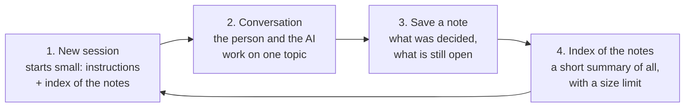
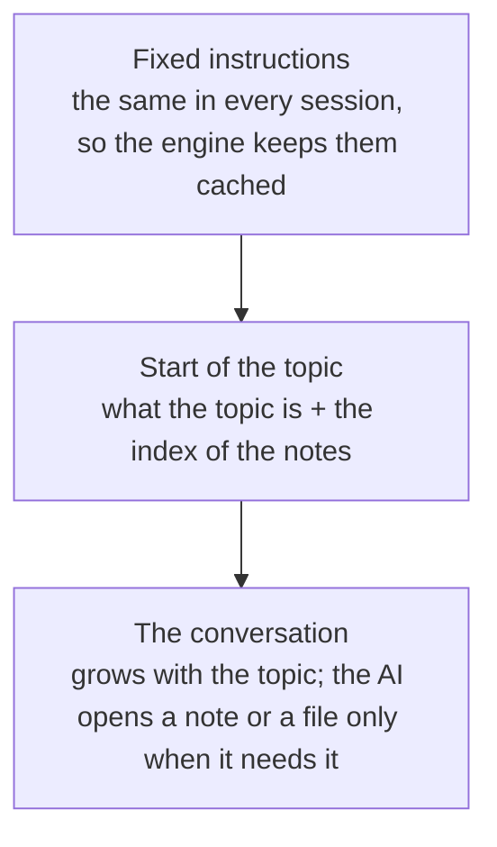

# Context and memory

Long-term memory belongs to the harness; short-term memory belongs to the engine.

## At a glance

The engine forgets; the harness remembers. Each topic runs in a fresh session. When it ends, what matters is saved as a short note, and the conversation is dropped. The next session starts from a short index of the notes, never from old conversations.

If a conversation gets too long before the topic ends, the app saves a note halfway too, so nothing decided is lost when the engine compresses its memory.

What the AI reads in a session, from what never changes to what grows:

Each topic also runs on the model it needs: a small one for simple work, a big one for hard work, chosen when the topic starts and kept until it ends.

## One session per task

- A task is one topic or unit of work: a manifest action, or a free question.
- The app drives the flow (`packages/shell/src/main/task-manager.ts`): idle → running → waiting → closing → idle. A message while waiting follows up in the same session. Picking "next" or another topic closes the current task.
- Closing sends one quiet last turn in the same session (`CLOSE_PROMPT` in `task-prompts.ts`) asking the agent to call `save_note` (a task that used modes also asks it to say what each was good for, and the note's front matter lists their ids). The app validates the note and writes `.harness/notes/<action>.md`, or `.harness/notes/q-<title>.md` for a free question (`q-<title>-2.md`, `-3`… when that name is taken) (`packages/workspace/src/notes.ts`). Then the session is ended: Claude starts the next one with a new `--session-id`, Codex gets `session/close`.
- An action may split its task into ordered parts (`phases`) inside that one session, and the last part may be the close (`close: true`): its end is this same closing turn. A time box runs one wrap-up turn near the end, then moves to the close part (`docs/architecture/phases.md`).
- Cancel, a failed first turn, an engine switch or quitting end the task without a note and mark it unfinished.
- The state lives in `.harness/tasks.json` (`packages/shell/src/main/task-store.ts`).

## What a new session gets

- Everything the agent reads is English. The managed section of `AGENTS.md` tells it to think in English, to write what the person sees in their language (the saved tag by its English name, `languageName` in `harness-sdk`), and to write notes in English.
- The stable instructions: `AGENTS.md` with its managed section. With harness settings, the section has their sentences under "How to work with this person". `AGENTS.md` only changes between tasks, and only when its text changed, so a running session keeps its cached prefix and the next one reads the new text (`docs/architecture/settings.md`). A task that goes on in a new session (after "Move folder", which keeps the open task) reads the settings as they are then; a restart never carries a task over, since startup ends a task left open.
- The first message: the task's brief plus the notes index (`buildNotesIndex` in `packages/workspace/src/notes-index.ts`): what was covered and the decisions so far, newest first, about 1,500 tokens at most. Older notes keep only their title and path; the agent opens a note with its read tool when it needs the details.
- In an action with modes, the first message adds the mode's section (or, by default, the list of modes to recommend from); a switch of mode is one more turn of the same session with the new mode's brief, so the session and its cache stay. A resumed session's first message carries the current mode (`docs/architecture/modes.md`).
- In an action with phases (`docs/architecture/phases.md`), the first message adds `## Parts of this task` (how to use `set_phase`, then one `` - `id` (Label) `` line per part, the current one marked `← now`) and `## Part: <label>` with the first part's brief. No extra turn runs at the start. With a time box, the message ends with `Time left: about N minutes.`
- Moving to another part is one more run turn of the same session: "Next part of this task", the time left, the part's brief and any mode section. A part's brief is filled with `{{language}}`, `{{phase}}` (its label), `{{previousPhase}}` (the label of the part before) and `{{timeLeft}}` (`about N minutes`, empty without a time box); never `{{notesIndex}}`, since the session already has the index. A resumed session's first message carries the list of parts and the current part's section after the mode's.
- In a harness with profiles (`docs/architecture/profiles.md`), everything above is the active profile's: `AGENTS.md` (and the engine's own instructions file) is written in the profile's folder, which is the agent's working folder, with that profile's settings; the notes, the index and the tasks are the profile's. The agent knows the person only through the `profile` collection's `context`.
- In a harness with scopes, the notes index is the open scope's, followed by a short app-wide one (`APP_INDEX_TOKENS`, 500). Collections with `context` add their tables after it, each within its own `tokens` (`docs/architecture/data.md`).
- In a harness with `material`, a task in a scope with usable material gets a `## Material` section last: the first message's order is the notes index, the app-wide notes, the data tables, then the material (the scope's grounding rule, the sheet and index rows within `budget.indexTokens`; `materialContext` in `task-manager.ts`). The strict or mixed rule is per scope, so it rides here, not in `AGENTS.md`. `AGENTS.md`'s managed section gets a `### Material` part with the rules that hold in every mode: fetch fragments with `material_read` and `material_search` and never open `.harness/material/`, cite as `[[frag:<id>]]`, follow the material when it and your knowledge disagree, say so once and call `material_conflict`, and call `material_flag` on a fragment that reads wrong. Without `material`, neither exists (`docs/architecture/material.md`).

## Models and context caps

- Each task runs at a level: `light`, `standard` or `deep`. The manifest recommends one per action (`tier`) and for free questions (`questions.tier`); the person can change each task's level, or make it custom, in Settings › Modelos (`config.json` → `models`).
- A mode may ask for a minimum tier (`minTier`). Switching to it from a task below asks the person first: continue at the task's level, or close it and start a new task at the mode's level (`resolveProfile`'s `floor`, which raises a lower tier and never lowers a higher one). The task's level still never changes mid-task (`docs/architecture/modes.md`).
- When a task starts, `resolveProfile` (`packages/shell/src/main/models.ts`) turns its level into a model, an effort and a context cap for the engine in use, from the person's table or the core's (`DEFAULT_TIERS` in `packages/engines/src/models.ts`). The profile is stored with the task in `tasks.json` and never changes until the task ends, so the engine's prompt cache stays valid.
- Claude gets `--model`, `--effort` and `--autocompact` on every call of the task; Codex gets the same through `CODEX_CONFIG` when its adapter starts (a new process when the next task needs another profile). OpenCode gets the model and effort through `session/set_config_option` before the turn, with no restart and no cap (it compacts on its own; `docs/architecture/engines.md`).
- A model the plan doesn't include ends the first turn with `model-unavailable`; the task runs again one level down (deep → standard → light → the engine's default model) and the screen says so. On Codex a model missing from its saved list is skipped before the turn.

## Checkpoints

- After each turn the task keeps the context in use (`context` events: Claude's last call, Codex's `usage_update`).
- At 80% of the cap (`CHECKPOINT_AT` in `task-manager.ts`), before the next follow-up (a phase change turn and the wrap-up included, still in the part the task leaves), a quiet turn asks the agent for `save_note`: the decisions so far go to the task's note before the engine compacts on its own. The row says "Guardando lo importante…".
- After a compaction (Codex reports it; for Claude the context falls by more than half) the next checkpoint can run again.

## Measuring

`.harness/usage.jsonl` records each turn's tokens with its `task`, `phase` (the turn kind: `run`, `close`, `checkpoint`, `phase-change` or `wrap-up` for a task with phases or a time box, and `context-add` for an "Add now" turn), `mode` (for a task in a mode), `taskPhase` (the part a phased task is in, on its compaction lines too), level, model, effort and cap, and the model the engine said it ran (`reportedModel`). Compactions are lines of `kind: "compaction"`.

## Engine switch

The chat is archived, the open task ends unfinished, the notes stay: the next task on the new engine gets the same index (`packages/shell/src/main/engine-switch.ts`). In a harness with profiles every profile's chat is archived at once (`archiveChatsOnEngineChange`).

## What the person sees and steers (context panel)

The context panel (spec `docs/superpowers/specs/2026-10-27-context-panel-design.md`, plan 17) shows what the agent takes into account in the open task and lets the person change it. It opens from the context meter, which is a button ("What the AI takes into account") in the flow side, or in the top bar for a harness without actions while a task with a context reading is open; the button keeps the meter's reading for screen readers (`aria-describedby`). The panel takes the reader's slot: opening it closes the reader, the file timeline panel, History and notes, and they close it in turn. An item opens in the reader (a `.md`, a note) or the file timeline panel (any other file), closing the panel. Close and Esc return focus to the meter (or, if it is gone, to the meter on screen, then the composer). The panel closes when the task ends. Harness views get `client.context` and `<ContextPanel client taskId />` from `@humanharness/ui`.

The panel has four sections: "At the start" (each item with its estimate, the total and the real first-turn tokens), "During the task" (reads and tools newest first, with "×N"), "Pinned" (with "title only", "not found" or "not a text file"; only a pin that enters whole shows its size, since a title-only pin costs one line) and "Excluded" (with "Include again"). "Exclude" sits next to each note an index item lists, "Pin" next to each read with a path, "Remove" next to each pin. An exclusion of a note the open task's index listed says "Applies from the next task". Focus: the "Add…" menu's first item gets focus when it opens; Esc closes only the menu and returns to "Add…"; after a pick, focus goes to "For this task"; after an add or a pin, back to "Add…". It is not a modal, so Tab is not trapped. A late answer for another task is dropped.

### What the app records

All of it lives on the open task in `.harness/tasks.json` (`CurrentTask`, app-private, never tracked by the history), cleaned field by field on read (`task-store.ts`). A task without these fields gets none back.

- **`start`**: what the first message held, as `ContextItem`s (`contextFor` and `startItems` in `task-manager.ts`): `instructions` (`AGENTS.md`, only when it exists), `brief`, `notes` and `app-notes` (with the notes each lists, at most 50, for the "Exclude" buttons), one `data:<collection>` item per table (`buildDataContextParts`), `pin:<scope>:<path>` items and `material`. At most 100 items. Sizes are estimates: `approxTokens` is characters ÷ 4 (for `AGENTS.md`, its bytes ÷ 4) rounded to the nearest 100, at least 100 for any text, 0 for none. The brief is the whole message's estimate minus the other items' (never below 0), so the items add up to the message. A resumed task (after "Move folder") replaces `start` with its resume message's items; its brief is "Task brief" for an action's task (even when the brief could not be read) and "Question" for a free question. A mode switch adds `brief:<n>` "Mode brief · <label>" and a phase change "Phase brief · <label>", each with the time it arrived (`at`); a Stop that cancels the switch before its send takes the item back. The first phase's brief and a starting mode's section are inside the first `brief`. On read, an item with an empty label, or a pin without its path or scope, is dropped, and times longer than 40 characters are not kept.
- **`startTokens`**: the first turn's `usage` (input + cache read + cache write), the engine's own report. The panel shows it as "First turn: N tokens (real)" next to "Total: approx. N tokens". A resume clears it and the resumed turn's usage sets it again; a first turn that reports no usage leaves it unset.
- **`reads`**: what the agent read or used during the task, from the runtime's `activity` events (`paths` and `tool`, `docs/architecture/turn.md`): Claude's `Read`, `Grep` and `Glob`; Codex's read and search `locations`; MCP tools of every server but `ui` (the core's `data` and `material` included, "data · data_query"). Paths are made folder-relative (`folderPath` in `context-record.ts`; the folder as given and its real path both count, since engines report `/private/var/…` for a folder under `/var/…`). A path outside the folder (a reference folder) keeps only its file name and never opens. Only a read (Claude's `Read`, Codex's `read`) keeps a `path`, so only reads offer Pin and open; a search (Grep, Glob, Codex's `search`) usually names a folder, so it is a label only: "Search · src", "Search · whole folder" for the folder itself, "Search · <name>" outside it. At most 20 paths per event, merged into the task once per turn when it ends (one `tasks.json` write), at most 500 entries per task, each with `firstAt` and a `count`. Nothing is ever read from an engine path: it is only turned into a string for display.
- **`compacted`**: a compaction (reported by Codex, or Claude's context falling by more than half, as `track` already detects) marks every `start` item and every read `compacted: true` in the same write; a file read again loses the mark. A reported compaction also marks the reads the same turn made before it (the turn keeps its position); a compaction seen only as the context falling has no position, so that turn's reads stay fresh. A resume marks the old session's reads, since the new session never saw them. The panel draws marked items faint with "may be summarized".

Engine paths never reach the window: `TurnController` strips `paths` and `tool` before an event reaches it (`forWindow`), and the chat log keeps `{ kind, detail }` only. `start` and `reads` reach the window only through `hh:contextGet`. Main sends `hh:context` (`{ task, context }`) when the open task's record, its pins or its exclusions change, panel open or not; `get` reads a scope's notes (for the excluded notes' titles) only when that scope excludes something, so a harness that never uses the panel pays one missing-file read per scope and the config read for the budget; `client.context.onChange(taskId, cb)` passes only the matching task.

### Pins and exclusions

The person's choices live in `.harness/context/<scope>.json` (`packages/workspace/src/context.ts`): `{ "version": 1, "pinned": [{ "path", "at" }], "excluded": [{ "note", "at" }] }`. The scope is `main` without scopes, an open scope, or `_app` for the whole app ("Pin for the whole app", offered only with scopes). At most 50 pins and 200 exclusions per scope (`full` past that). A file that is not JSON or has the wrong shape reads as empty; the next write replaces it. The file is written atomically and removed when it becomes empty, so a folder that pinned and unpinned looks like one that never did. `CONTEXT_PREFIX` is in `appHistoryKeep`, so the file is tracked.

- **Written only by the panel** (`ContextService` in `packages/shell/src/main/context.ts`). Each pin, unpin, exclusion and inclusion is one commit, `Context: pinned <path>`, `Context: unpinned <path>`, `Context: excluded <note>` or `Context: included <note>`, with the open task's trailer, so undoing the task undoes it; the History panel shows them as `Context:` entries. Writes run through one queue across all scopes (the file is load, change, save with no lock), and are refused with `busy` while the app's history is busy (a restore, a folder move, an engine change).
- **What a pin may be** (`checkPinPath` in `context-pins.ts`), checked when the action runs, whatever the window sent (a start item's path comes from the hand-editable `tasks.json`): a plain relative path with no empty, `.` or `..` part; never a `.git` part at any depth, nothing under `.claude/`, and under `.harness/` only inside `.harness/notes/` (compared without case). Its name must fit a prompt: no backtick, control character, line or paragraph separator, bidi control (U+202A–202E, U+2066–2069) or zero-width character (U+200B–200D, U+FEFF), at most 1,000 characters (`bad-name`, "File names with a backtick or a line break can't be used."). `locate` then requires the real path to be inside the folder, and that real path must pass the same shape rule, so a link into `.git` or `.harness` is `outside`. Reference folders are never tried. Reads go through `readPrefix` and `readCapped`, which refuse links and hard links. A binary file (the file timeline's `isBinary`: a known extension or a NUL in the first 8 KB) is `binary`. Refusals: `outside` ("Only files in your folder"), `bad-name`, `binary` ("Text files only"), `missing`.
- **Unpin and include** accept any stored name (nothing is read), so a hand-edited entry with an odd name can still be removed; its commit subject quotes it, with every character `addablePath` refuses escaped as `\uXXXX` (JSON alone leaves bidi, zero-width, DEL, C1 and U+2028/9 as they are), so the subject stays one visible line.
- **What an exclusion may be**: a note directly in that scope's notes folder (`notesPrefix` + `<slug>.md`, nothing deeper), else `not-a-note`. On read, the file keeps only exclusions under `.harness/notes/`; a bad scope throws on read as on write (answered `failed`), never read as an empty file.
- **Answers are data.** Every `hh:context*` handler (`context-ipc.ts`: `hh:contextGet`, `hh:contextAdd`, `hh:contextPick`, `hh:contextPin`, `hh:contextUnpin`, `hh:contextExclude`, `hh:contextInclude`) answers `{ ok: true, … }` or `{ ok: false, reason }` (`ContextRefusal`: `no-task`, `busy`, `outside`, `bad-name`, `binary`, `missing`, `unknown-scope`, `not-a-note`, `full`, `not-ready`, `failed`). A throw or a rejection inside is a bug, logged and answered `failed`; the preload (`preload/context.ts`) turns a rejection or a non-data answer into `failed` too. `pick` opens the system dialog at the folder and checks the file like an "Add now"; the dialog may answer with the folder's real path, and both spellings count. One dialog at a time: a pick while one is open is refused with `busy`.

### A new task's first message

With pins or exclusions, a new task's first message is, in order: the scope's notes index and the app-wide one (each without its excluded notes, `buildNotesIndex`'s `exclude`), the data tables, **the pinned section**, then the material, which stays last. A scoped task gets its scope's pins, then `_app`'s, under one shared budget.

- **The budget**: `config.json` → `models.pinnedTokens` (Settings › Models, `docs/architecture/settings.md`), else the manifest's `context.pinnedTokens`, else 3,000 (`pinnedBudget` in `packages/shell/src/main/models.ts`). A pin's size is its bytes ÷ 4 rounded up, the same number for the panel and the message.
- **Strict order** (`pinsLayout`): pins enter whole in order while they fit; the first that does not fit, and every pin after it, enters as title only (no skipping ahead to smaller ones). A file over 1 MB is always title only. A missing or binary pin, or one whose link now leads out, is skipped, and the panel shows why.
- **The section** (`pinnedSection`): `## Pinned by the person`, each whole pin as `### <path>` and its text in a backtick fence one longer than its longest backtick run (at least 3), then `### Also pinned` with one `- <title> → <path>` line per title-only pin (the title is the first `# ` heading in the first 2 KB, else the file name) and "Open these with your read tool when you need them." Each pin is checked and read again right before it enters, up to the size the layout measured (`pinnedText` in `context-pins.ts`): a file that grew since enters as title only, so the budget is never overrun.

### Add now

"Add…" offers "Choose a file…" (`hh:contextPick`) and the open scope's notes; the picked path then offers "For this task" or "Pin in <scope>". "For this task" is one turn of the open task (`TaskManager.addContext`), sent with `CONTEXT_ADD_PROMPT` (`task-prompts.ts`): ``The person wants you to take `<path>` into account. Read it now and say in one line what changes for this task.``

- `ContextService.add` checks the path like a pin, except that a binary file is allowed (the agent decides what it can read). The task manager then checks only that the name fits the prompt (`addablePath`).
- The turn goes through the task manager's operation queue: behind a running turn it waits (`whenFree`) and never cancels it; the panel shows "Waiting for the current turn to end…" until it is accepted. It is refused with `no-task` (no task open, or another task's id), `busy` (the task is not waiting: closing, saving a checkpoint) or `bad-name`.
- It runs like a follow-up: a due checkpoint first, the lines kept for the task's next message with it, a lost session resumed as a question would be. The person asked for it, so a paused time box runs again. When the app is closing, the operation that can no longer run is answered `busy`. Its kind in `usage.jsonl` is `context-add`. The window gets `hh:taskTurn` with `kind: "context"` and the path, and the chat's line is "Take <path> into account", stored in English as the app's own line.

### D0

A harness that never pins, never excludes and never uses "Add now" behaves exactly as before: no `.harness/context/` file, no pinned section, no `exclude` filter, so every first message is byte for byte the same; `AGENTS.md` and the MCP tool lists gain nothing; the chat log and the window's event stream are unchanged; `context-add` never appears in `usage.jsonl`; `humanharness run` wires the same hooks (`pinnedBudget({}, harness.context)`, no `contextChanged`) and prints the same messages; a manifest without `context` validates as before. What changes for every harness, on purpose: `tasks.json`'s open task gains `start`, `startTokens` and `reads`, `ModelsView` gains `pinnedTokens`, and the context meter becomes a button.

### Never read

The panel never reads `~/.claude`, `~/.codex`, `~/.gemini`, `~/.config/opencode`, `~/.local/share/opencode` or any engine account file. Usage, context and read paths come only from the engine's protocol output (stream-json and ACP), which the transports already parse.

### Known gaps

- First-turn tokens sum every API call of the first turn (Claude's usage covers the whole turn, tool calls included), so with tools they overstate the first message. The panel says "First turn", not "first message".
- Reads are recorded when the turn ends, not as each tool call happens, so the panel updates then. A compaction seen only as Claude's context falling has no position in the turn, so that turn's reads stay fresh.
- "Add now" checks the file when the action runs; the agent reads it later. Accepted, since the agent can already reach the folder.
- The "Add now" chat line ("Take <path> into account") is stored in English as the app's own line.
- An "Add now" turn is not one of the task's own turns for input blocks (`takesInputs` leaves out `context-add`): a block it shows gets no id.
- A path with a backtick is refused as `bad-name`, whose copy speaks of a backtick or a line break only.
- "App-wide notes (N)" counts every note the app index covers (not excluded), though that index is trimmed to 500 tokens. Accepted: N says how many notes it stands for.
- Grep and Glob without a `path`, and a Codex search without `locations`, record nothing.
- `hh:context` is computed on every record change even while the panel is closed (cheap without pins or exclusions, see above); with pins, each change re-checks every pinned file's size.
- Only reads are filled on `activity`: edit paths (the parallel tasks spec) are not.
- Not built (the plan's conflicts with the spec): scope-instructions items, pins in linked folders, jobs and the task cap, the agent proposing pins.
